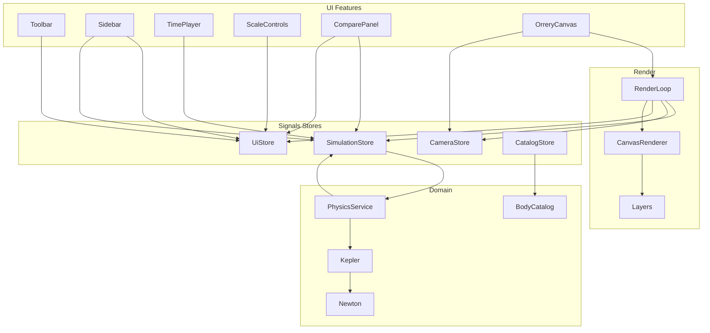

# 02 — Architecture (Angular 22+)

Создай приложение строго по этой архитектуре. Не сваливай физику в компоненты. Не используй NgRx/Akita — только Signals stores.

---

## 2.1 Стек и bootstrap

1. Создай проект Angular **latest stable ≥ 22**, standalone, SCSS, **без SSR**, без routing (или с одним пустым route — предпочтительно **без** `@angular/router`, если CLI позволяет).
2. Включи **zoneless** (дефолт новых приложений). Не добавляй `zone.js` обратно.
3. Prefix: `owp`.
4. Точка входа: `main.ts` → `bootstrapApplication(AppComponent, appConfig)`.
5. `app.config.ts`: `provideZonelessChangeDetection()` (или эквивалент актуального API), никаких `provideAnimations` обязательных (анимации панелей — CSS).

---

## 2.2 Дерево каталогов (обязательное)

```
src/
  index.html
  main.ts
  styles.scss
  app/
    app.component.ts
    app.component.html
    app.component.scss
    app.config.ts

    core/
      constants/
        astronomy.constants.ts
        scale.constants.ts
        time.constants.ts
        render.constants.ts
      models/
        celestial-body.model.ts
        orbital-elements.model.ts
        body-kind.model.ts
        simulation-state.model.ts
        camera-state.model.ts
        scale-mode.model.ts
        body-runtime-state.model.ts
        compare-state.model.ts
        theme.model.ts
        locale.model.ts
      tokens/
        canvas-context.token.ts   # опционально; можно без InjectionToken

    domain/
      astronomy/
        newton-raphson.ts
        kepler.ts
        orbital-transform.ts
        vis-viva.ts
        anomaly.util.ts
        julian.util.ts
      bodies/
        sun.data.ts
        planets.data.ts
        moon.data.ts
        dwarfs.data.ts
        comets.data.ts
        asteroid-belt.data.ts
        body-catalog.ts

    state/
      simulation.store.ts
      camera.store.ts
      ui.store.ts
      catalog.store.ts

    services/
      physics.service.ts
      render-loop.service.ts
      screenshot.service.ts
      hotkeys.service.ts
      i18n.service.ts

    features/
      orrery-canvas/
        orrery-canvas.component.ts
        orrery-canvas.component.html
        orrery-canvas.component.scss
        canvas-renderer.ts
        canvas-camera.ts
        canvas-pointer.controller.ts
        layers/
          starfield.layer.ts
          orbits.layer.ts
          asteroid-belt.layer.ts
          bodies.layer.ts
          rings.layer.ts
          labels.layer.ts
      sidebar/
        sidebar.component.ts
        sidebar.component.html
        sidebar.component.scss
        body-list.component.ts
        body-list.component.html
        body-list.component.scss
        body-card.component.ts
        body-card.component.html
        body-card.component.scss
      time-player/
        time-player.component.ts
        time-player.component.html
        time-player.component.scss
      scale-controls/
        scale-controls.component.ts
        scale-controls.component.html
        scale-controls.component.scss
        real-scale-banner.component.ts
        real-scale-banner.component.html
        real-scale-banner.component.scss
      compare/
        compare-panel.component.ts
        compare-panel.component.html
        compare-panel.component.scss
      toolbar/
        toolbar.component.ts
        toolbar.component.html
        toolbar.component.scss

    i18n/
      locale.type.ts
      dictionaries/
        ru.ts
        en.ts
      i18n.keys.ts

  app/
    # tests рядом с domain:
    domain/astronomy/newton-raphson.spec.ts
    domain/astronomy/kepler.spec.ts
    state/simulation.store.spec.ts
```

Имена файлов **фиксированы**. Не переименовывай произвольно.

---

## 2.3 Слои и границы ответственности



### Правила
1. **UI-компоненты** читают stores через `inject(...)`, вызывают методы store (`play()`, `selectBody(id)`). Не импортируют `kepler.ts` напрямую.
2. **PhysicsService** — чистые расчёты + обновление runtime state в `SimulationStore`. Не трогает DOM/Canvas.
3. **CanvasRenderer / layers** — только рисование из уже посчитанного snapshot state. Не считают Newton–Raphson.
4. **CameraStore** — pan, zoom, focusBodyId, follow flag.
5. **UiStore** — theme, locale, scaleMode, showLabels, showDwarfs, showComets, compareOpen, compareIds, sidebarOpen.
6. **CatalogStore** — статический каталог тел + derived lists (planets, dwarfs, comets, visibleBodies).

---

## 2.4 Signals Store — контракты

### `SimulationStore`
Writable signals:
- `isPlaying: signal(true)`
- `timeScaleDaysPerSecond: signal(1)` — сколько симуляционных суток проходит за 1 реальную секунду
- `simulationTimeDays: signal(0)` — дни от эпохи
- `bodyStates: signal<Record<BodyId, BodyRuntimeState>>({})`
- `selectedBodyId: signal<BodyId | null>('earth')`

Computed:
- `selectedBodyState`
- `selectedBodyDefinition`
- `speedPresetLabel` (через i18n снаружи)

Methods:
- `play()`, `pause()`, `togglePlay()`
- `setTimeScaleDaysPerSecond(v: number)`
- `setSpeedPreset('day' | 'month' | 'year' | 'hour')`
- `advance(realDtSeconds: number)` — вызывает PhysicsService и обновляет `simulationTimeDays` + `bodyStates`
- `selectBody(id)`, `clearSelection()`

### `CameraStore`
- `offsetX`, `offsetY` (world pan в screen space или world — зафиксируй один подход в `canvas-camera.ts`, документируй в коде комментарием-заголовком файла)
- `zoom: signal(1)`
- `followEnabled: signal(false)`
- `focusBodyId: signal<BodyId | null>(null)`
- methods: `panBy`, `zoomAt`, `enableFollow(id)`, `disableFollow()`, `resetView()`

### `UiStore`
- `theme: signal<'dark' | 'light'>('dark')`
- `locale: signal<'ru' | 'en'>('ru')`
- `scaleMode: signal<'real' | 'visual'>('visual')`
- `showLabels`, `showDwarfs`, `showComets`, `compareOpen`
- `compareBodyIds: signal<BodyId[]>` (max 3)
- methods для toggle/set + `toggleCompareBody(id)` с ограничением длины

### `CatalogStore`
- `allBodies` readonly из `body-catalog.ts`
- computed: `planets`, `dwarfs`, `comets`, `moon`, `sun`
- `visibleBodies` учитывает флаги UiStore (dwarfs/comets)

---

## 2.5 Цикл кадра

`RenderLoopService`:
1. Подписка на `requestAnimationFrame`.
2. Считает `dt = (now - last) / 1000`, clamp dt ≤ 0.05 (защита от tab freeze spike).
3. Если `simulationStore.isPlaying()` → `simulationStore.advance(dt)`.
4. Если follow → обновляет camera offset из позиции focused body (после physics).
5. Вызывает `canvasRenderer.draw(snapshot)`.
6. Старт loop в `OrreryCanvasComponent` `ngOnInit` / `afterNextRender`; stop в `ngOnDestroy` / DestroyRef.

**Важно для zoneless:** любое обновление signal в rAF автоматически триггерит CD для читающих шаблонов. Не вызывай `markForCheck`. Не мутируй объекты внутри signal — всегда новый immutable snapshot или точечный `update`.

---

## 2.6 AppComponent composition

`app.component.html` собирает:

```html
<owp-toolbar />
<main class="owp-shell">
  <owp-orrery-canvas class="owp-shell__canvas" />
  <owp-sidebar class="owp-shell__sidebar" />
</main>
<footer class="owp-shell__footer">
  <owp-time-player />
  <owp-scale-controls />
</footer>
<owp-real-scale-banner />
@if (ui.compareOpen()) {
  <owp-compare-panel />
}
```

(Имена классов допустимы скорректировать, структура — нет.)

`HotkeysService` инициализируется в `AppComponent` через `inject` + `DestroyRef`.

---

## 2.7 Зависимости npm

Разрешены только:
- Angular framework packages из CLI
- RxJS (как peer Angular; **не** использовать для state)
- testing libs CLI

**Запрещены:** three, pixi.js, p5, matter.js, ngrx, immer (опционально не нужен).

---

## 2.8 Именование

- `BodyId` = string union: `'sun' | 'mercury' | ... | 'moon' | 'ceres' | 'pluto' | 'eris' | 'halley' | 'encke'`
- Файлы kebab-case, классы PascalCase с префиксом фичи где нужно (`OrreryCanvasComponent`).
- Selectors: `owp-orrery-canvas`, `owp-sidebar`, …

---

## 2.9 Критерий готовности документа 02

Дерево папок создано, stores на signals, RenderLoop отделён от Physics, UI не импортирует kepler напрямую.
